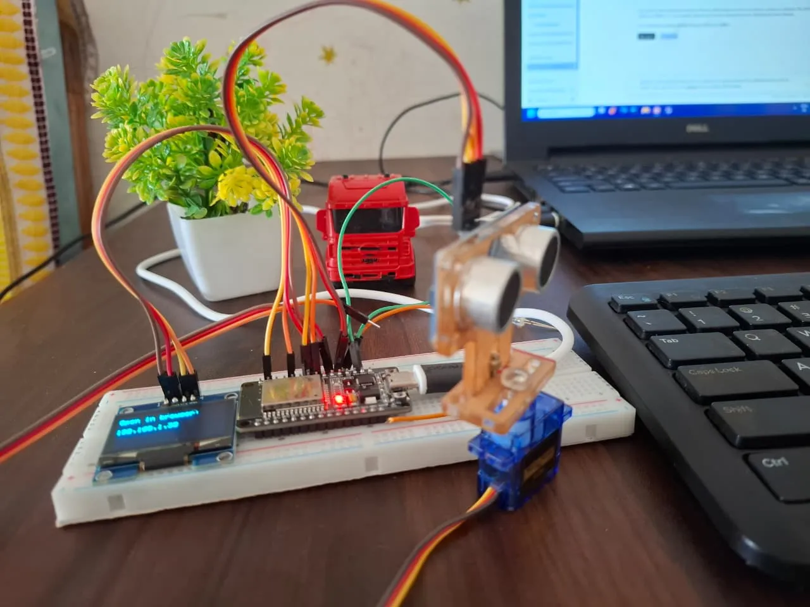
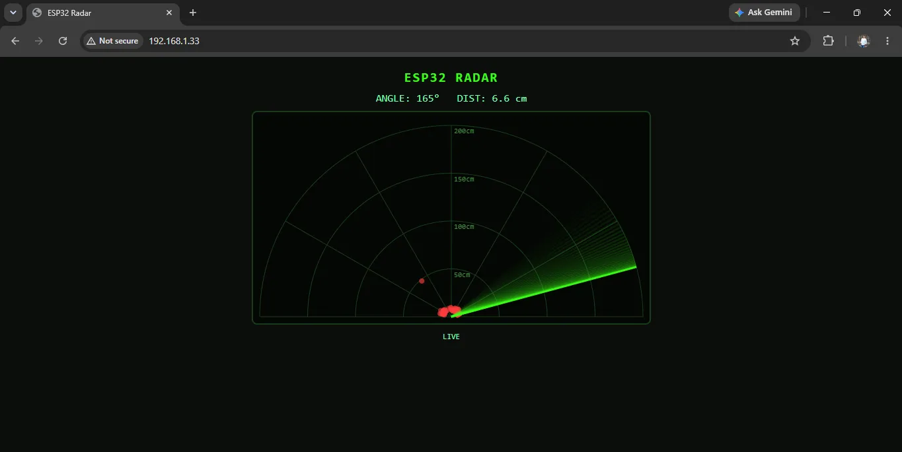

# ESP32 Ultrasonic Radar

A sweeping ultrasonic radar built with an ESP32, HC-SR04 and SG90 servo. It shows a live radar in your browser, draws a mini radar on a 1.3-inch OLED, and beeps a buzzer faster as objects get closer.

**Full step-by-step guide:** [solderhub.com](https://solderhub.com/projects/esp32-servo-ultrasonic-radar-web-dashboard)

## Parts

- ESP32 DevKit (WROOM-32)
- HC-SR04 ultrasonic sensor
- SG90 micro servo and sensor bracket
- 1.3-inch I2C OLED, SH1106 (optional)
- Active 3.3V buzzer
- 1 kΩ and 2 kΩ resistors
- External 5V supply for the servo, 470 µF capacitor recommended

## Wiring

| Part | Pin | ESP32 |
|---|---|---|
| HC-SR04 | VCC | VIN (5V) |
| HC-SR04 | GND | GND |
| HC-SR04 | TRIG | GPIO5 |
| HC-SR04 | ECHO | 1 kΩ to GPIO18, with 2 kΩ from GPIO18 to GND |
| SG90 | Orange | GPIO15 |
| SG90 | Red | External 5V |
| SG90 | Brown | External GND, shared with ESP32 GND |
| OLED | VCC / GND | 3V3 / GND |
| OLED | SDA / SCL | GPIO21 / GPIO22 |
| Buzzer | + / - | GPIO4 / GND |

Never connect ECHO directly to the ESP32: it outputs 5V and the pins are rated for 3.3V.

## Setup

1. Install the ESP32 boards package in Arduino IDE and select **ESP32 Dev Module**.
2. Install the libraries **ESP32Servo**, **Adafruit SH110X** and **Adafruit GFX Library**.
3. Open `esp32_radar/esp32_radar.ino` and set `WIFI_SSID` and `WIFI_PASS`.
4. Upload, then open the IP address shown on the OLED or Serial Monitor at 115200 baud.

If Wi-Fi isn't available, the ESP32 creates a network called `ESP32-Radar`. Change `AP_PASS` before deploying it.

## Settings

| Setting | Default | Purpose |
|---|---|---|
| `SWEEP_ONE_WAY_MS` | 3000 | Sweep time, higher is smoother |
| `SWEEP_MIN`, `SWEEP_MAX` | 15, 165 | Sweep limits in degrees |
| `MAX_CM` | 200 | Radar range |
| `BUZZER_ALERT_CM` | 50 | Buzzer range, 0 for silence |
| `FLIP_DISPLAY` | false | Mirrors the radar display |
| `USE_OLED` | 1 | Set to 0 without a display |

---

Made for [SolderHub](https://solderhub.com).
